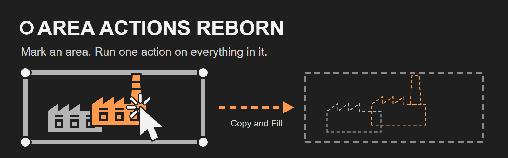

# Area Actions Reborn

A mod for Satisfactory 1.x. Mark an area with the Area Actions tool and run one action on everything in it:

- **Set Recipe**: one recipe for every machine in the area that accepts it.
- **Clear Inventories**: empty every building, into crates or for good.
- **Set Station Load/Unload**: switch every freight platform in the area.
- **Copy**: build a copy of the area's buildings somewhere else, with a preview.
- **Fill**: repeat the area's buildings in a grid, with a preview.
- **Mass Dismantle**: take down everything in the area, with the refund in crates.

Foundations, walls and the other lightweight buildings count like every other building. The mod works in single player, on a host with
clients and on a dedicated server; every player and the server need the same version.

This is a port of [Area Actions](https://github.com/mircearoata/SatisfactoryAreaActions) by Mircea Roata, which stopped working with
Update 8. The logic moved from Blueprints into a C++ module that runs every action on the server, in slices, so that large areas do not
freeze the game.

## Requirements

- Satisfactory 1.x, changelist 520140 or newer
- Satisfactory Mod Loader (SML) 3.12.1 or newer

## Settings for a server

Console variables, with their defaults:

| Variable | Default | Meaning |
|---|---|---|
| `AreaActions.ServerBudgetMs` | 2.0 | Time per frame the server spends on area actions, for all players together (ms) |
| `AreaActions.MaxSpawnPerRequest` | 10000 | Most buildings one Copy or Fill may build |
| `AreaActions.DismantleActorsPerFrame` | 25 | Most building actors one Mass Dismantle takes down in a frame |
| `AreaActions.MaxCorners` | 256 | Most corners an area may have |
| `AreaActions.MaxDistance` | 0 | Farthest an area may be from the player (cm); 0 = no limit |
| `AreaActions.MaxContainerDistance` | 1000000 | Farthest a container may be from the player to pay a Copy or Fill (cm) |
| `AreaActions.PreviewHolograms` | 300 | Most copies a preview shows as the game's own holograms |

## Building from source

Set up the modding environment as the [modding documentation](https://docs.ficsit.app/) describes, put this repository into the
`Mods/AreaActionsReborn` folder of the starter project and package it with Alpakit.

The module has a test mode for development: the game started with `-AATest=<Scenario>` runs one scripted scenario and writes
`AATEST RESULT <Scenario> PASS` or `FAIL` to its log. Without that argument the test mode does nothing. The scenarios are in
`Source/AreaActionsReborn/Private/AreaActionsTests.cpp`.

## Credits and licence

Original mod: Mircea Roata. Port to Satisfactory 1.x: BRTMN. The icon is based on the icon of the original Area Actions.

GPL-3.0, see [LICENSE](LICENSE).
